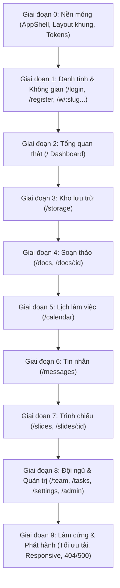

# Kế hoạch Triển khai Giao diện Người dùng (UI Implementation Plan)

Tài liệu này chuẩn hoá lộ trình hiện thực hoá toàn bộ giao diện của dự án WORKSPACE theo đúng đặc tả tại `/docs/SPEC.md` (Mục 5, Mục 7 và Mục 10), tuân thủ nghiêm ngặt quy tắc trong `/AGENTS.md`.

---

## 1. Bảng độ phủ Giao diện (UI Coverage Matrix)

Mỗi route tương ứng với một dòng, tổng hợp toàn bộ các màn hình được quy định tại Mục 7 của SPEC:

| Route                                        | Tên màn hình                            | Mã FR liên quan                   | Tình trạng Mockup / Thiết kế                                                                                                                                              | Trạng thái Code hiện tại                                                                    | Giai đoạn triển khai (SPEC Mục 5) | Trạng thái bắt buộc (SPEC 7.11)                                                                                                                                                                              |
| :------------------------------------------- | :-------------------------------------- | :-------------------------------- | :------------------------------------------------------------------------------------------------------------------------------------------------------------------------ | :------------------------------------------------------------------------------------------ | :-------------------------------: | :----------------------------------------------------------------------------------------------------------------------------------------------------------------------------------------------------------- |
| `/`                                          | **Tổng quan (Dashboard)**               | `FR-DASH-01..09`, `FR-TASK-01,02` | **Có mockup baseline chuẩn:** • `docs/design/baseline/dashboard-1440.png` • `docs/design/baseline/dashboard-1024.png` • `docs/design/baseline/dashboard-390.png` | **Đã có:** `apps/web/src/pages/DashboardPage.tsx` _(Đang dùng fixtures, chờ nối API)_ |          **Giai đoạn 2**          | • Tải: Skeleton từng thẻ • Rỗng: Empty card • Lỗi: Retry button • 403: Chặn thẻ không gian                                                                                                          |
| `/login`                                     | **Đăng nhập**                           | `FR-AUTH-02`, `FR-AUTH-03`        | **Có mockup ảnh:** • `docs/design/phase1/login-1440.png` • Mô tả bảng SPEC 7.1                                                                                      | **Đã có:** `apps/web/src/pages/auth/LoginPage.tsx`                                       |          **Giai đoạn 1**          | • Tải: Button spinner • Lỗi: Thông báo chung an toàn • Khoá: Banner 15 phút                                                                                                                            |
| `/register`                                  | **Đăng ký tài khoản**                   | `FR-AUTH-01`                      | **Mô tả chữ:** SPEC 7.1 (thanh đo độ mạnh mật khẩu)                                                                                                                       | **Đã có:** `apps/web/src/pages/auth/RegisterPage.tsx`                                    |          **Giai đoạn 1**          | • Lỗi validation 422 • Đang gửi: Loading button                                                                                                                                                           |
| `/forgot-password`                           | **Quên mật khẩu**                       | `FR-AUTH-04`                      | **Mô tả chữ:** SPEC 7.1                                                                                                                                                   | **Đã có:** `apps/web/src/pages/auth/ForgotPasswordPage.tsx`                              |          **Giai đoạn 1**          | • Thành công: Trạng thái chờ 60s • Lỗi: Retry                                                                                                                                                             |
| `/reset-password`                            | **Đặt lại mật khẩu**                    | `FR-AUTH-04`                      | **Mô tả chữ:** SPEC 7.1                                                                                                                                                   | **Đã có:** `apps/web/src/pages/auth/ResetPasswordPage.tsx`                               |          **Giai đoạn 1**          | • Token hết hạn (404/410) • Thành công: Điều hướng login                                                                                                                                                  |
| `/2fa`                                       | **Xác thực hai lớp (TOTP)**             | `FR-AUTH-05`                      | **Mô tả chữ:** SPEC 7.1 (6 ô số tự chuyển, link mã dự phòng)                                                                                                              | **Đã có:** `apps/web/src/pages/auth/TwoFactorPage.tsx`                                   |          **Giai đoạn 1**          | • Lỗi: Mã sai/hết hạn • Loading check mã                                                                                                                                                                  |
| `/accept-invite/:token`                      | **Chấp nhận lời mời**                   | `FR-WS-04`                        | **Mô tả chữ:** SPEC 7.1 (hiện tên workspace, người mời, vai trò)                                                                                                          | **Đã có:** `apps/web/src/pages/auth/AcceptInvitePage.tsx`                                |          **Giai đoạn 1**          | • Lỗi: Token hết hạn/không tồn tại (404) • Thành công: Vào workspace                                                                                                                                      |
| `/onboarding`                                | **Onboarding lần đầu**                  | `FR-AUTH-07`, `FR-WS-01`          | **Mô tả chữ:** SPEC 7.1 (3 bước: hồ sơ → không gian → mời đồng đội)                                                                                                       | **Đã có:** `apps/web/src/pages/auth/OnboardingPage.tsx`                                  |          **Giai đoạn 1**          | • Bước tiếp theo • Nút Bỏ qua                                                                                                                                                                             |
| `/w/:slug`                                   | **Trang chủ Không gian**                | `FR-WS-01..07`                    | **Có mockup ảnh & wireframe:** • `docs/design/phase1/workspace-1440.png` • Wireframe text SPEC 7.2                                                                  | **Đã có:** `apps/web/src/pages/workspace/WorkspaceDetailPage.tsx`                        |          **Giai đoạn 1**          | • Tải: Skeleton 6 tab • Rỗng: Empty state • Lỗi: Error panel • 403: Yêu cầu quyền truy cập • 404: Không tìm thấy slug                                                                            |
| `/w/:slug/settings`                          | **Cài đặt Không gian**                  | `FR-WS-05,06,08`                  | **Có mockup ảnh:** • `docs/design/phase1/settings-1440.png` • Mô tả chữ SPEC 7.2                                                                                    | **Đã có:** `apps/web/src/pages/workspace/WorkspaceSettingsPage.tsx`                      |          **Giai đoạn 1**          | • 403: Chỉ Owner/Admin được vào • Tải: Skeleton tab • Xác nhận nguy hiểm (xoá/lưu trữ)                                                                                                                 |
| `/storage`                                   | **Kho lưu trữ**                         | `FR-STO-01..13`                   | **Wireframe text:** SPEC 7.7 (Bảng/lưới tệp, breadcrumb, panel tải lên nổi góc dưới phải, drawer chi tiết phải, tab Dung lượng 128.4/500 GB)                              | **Placeholder:** `apps/web/src/pages/PlaceholderPage.tsx`                                |          **Giai đoạn 3**          | • Tải: Skeleton bảng tệp • Rỗng: Kéo thả tải tệp đầu tiên • Lỗi: Thẻ thử lại • 403: Không có quyền truy cập tệp/thư mục • 404: Thư mục không tồn tại                                             |
| `/docs`                                      | **Danh sách Tài liệu**                  | `FR-DOC-01,10,12`                 | **Wireframe text:** SPEC 7.3 (Thẻ/danh sách tài liệu, 5 tab, bộ lọc không gian, thumbnail trang đầu)                                                                      | **Placeholder:** `apps/web/src/pages/PlaceholderPage.tsx`                                |          **Giai đoạn 4**          | • Tải: Skeleton lưới thẻ • Rỗng: Nút Tạo tài liệu trống / Chọn mẫu • Lỗi: Retry button • 403: Giới hạn theo không gian                                                                              |
| `/docs/:id` _(hoặc `/w/:slug/docs/:id`)_     | **Trình soạn thảo Tài liệu**            | `FR-DOC-02..09, 13..17`           | **Wireframe text:** SPEC 7.3 (Topbar sửa tên, thanh công cụ TipTap, mục lục trái, trang A4 giữa, bình luận phải, ngăn lịch sử phiên bản trượt phải)                       | **Chưa có file riêng** _(chưa khai báo trong router)_                                       |          **Giai đoạn 4**          | • Tải: Skeleton trang A4 • Ngoại tuyến: Banner vàng "Bạn đang ngoại tuyến" • Lỗi kết nối Yjs: "Đang kết nối lại..." • 403: Chỉ xem / Yêu cầu quyền sửa • 404: Tài liệu đã xoá hoặc không tồn tại |
| `/calendar`                                  | **Lịch làm việc**                       | `FR-CAL-01..13`                   | **Wireframe text:** SPEC 7.5 (Lưới thời gian ngày/tuần/tháng, mini-calendar trái, popover sự kiện, form tạo sự kiện phải, tab tìm giờ chung)                              | **Placeholder:** `apps/web/src/pages/PlaceholderPage.tsx`                                |          **Giai đoạn 5**          | • Tải: Skeleton lưới lịch • Rỗng: Không có sự kiện • Lỗi: Lỗi đồng bộ lịch • 403: Xem lịch riêng tư                                                                                                 |
| `/messages` _(hoặc `/messages/:channelId`)_  | **Tin nhắn**                            | `FR-MSG-01..14`                   | **Wireframe text:** SPEC 7.6 (Bố cục 3 cột: Danh sách 300px, Luồng tin, Chi tiết kênh 320px / Luồng trả lời thread phải, ô soạn tin)                                      | **Placeholder:** `apps/web/src/pages/PlaceholderPage.tsx`                                |          **Giai đoạn 6**          | • Tải: Skeleton tin nhắn • Rỗng: Kênh chưa có tin nhắn nào • Mất mạng: Thanh "Đang kết nối lại..." • Lỗi: Không gửi được tin (Retry icon) • 403: Kênh riêng tư                                   |
| `/slides`                                    | **Danh sách Bản trình chiếu**           | `FR-SLD-01,02`                    | **Mô tả chữ:** SPEC 6.7 (Lưới thumbnail 16:9, thư viện mẫu bố cục)                                                                                                        | **Placeholder:** `apps/web/src/pages/PlaceholderPage.tsx`                                |          **Giai đoạn 7**          | • Tải: Skeleton lưới 16:9 • Rỗng: Nút Tạo slide mới / Mẫu • Lỗi: Retry button • 403: Quyền xem bản trình chiếu                                                                                      |
| `/slides/:id` _(hoặc `/w/:slug/slides/:id`)_ | **Trình soạn thảo Trình chiếu**         | `FR-SLD-03..05, 07, 09, 10`       | **Wireframe text:** SPEC 7.4 (Dải trang trái kéo-thả, Canvas 16:9 giữa zoom được, bảng thuộc tính phải, ghi chú diễn giả dưới)                                            | **Chưa có file riêng** _(chưa khai báo trong router)_                                       |          **Giai đoạn 7**          | • Tải: Skeleton canvas • Lỗi đồng bộ Yjs • 403: Chế độ chỉ xem • 404: Không tồn tại                                                                                                                 |
| `/slides/:id/present`                        | **Chế độ Trình chiếu & Diễn giả**       | `FR-SLD-06,08`                    | **Mô tả chữ:** SPEC 7.4 (Toàn màn hình, thanh điều khiển tự ẩn, presenter view có đồng hồ và trang kế)                                                                    | **Chưa có file riêng** _(chưa khai báo trong router)_                                       |          **Giai đoạn 7**          | • Tải: Black screen loader • Lỗi: Không thể nạp trang slide                                                                                                                                               |
| `/team`                                      | **Đội ngũ**                             | `FR-TEAM-01..08`                  | **Có mockup HTML & ảnh chụp:** • `docs/design/team.html` • `docs/design/team-wireframe/team-1440.png` • Wireframe text SPEC 7.8                                  | **Placeholder:** `apps/web/src/pages/PlaceholderPage.tsx`                                |          **Giai đoạn 8**          | • Tải: Skeleton bảng danh bạ • Rỗng: Không tìm thấy thành viên khớp bộ lọc • Lỗi: Thẻ lỗi kèm requestId • 403: Quyền hạn thành viên/khách                                                           |
| `/tasks` _(hoặc `/w/:slug/tasks`)_           | **Trang Công việc**                     | `FR-TASK-01..07`                  | **Wireframe text:** SPEC 7.9 (Bảng Kanban 3 cột kéo-thả, bộ lọc, ngăn chi tiết công việc phải)                                                                            | **Chưa có file riêng** _(chưa khai báo trong router)_                                       |          **Giai đoạn 8**          | • Tải: Skeleton 3 cột Kanban • Rỗng: "Chưa có công việc nào" • Lỗi: Retry button • 403: Quyền hạn workspace                                                                                         |
| `/notifications`                             | **Trung tâm Thông báo**                 | `FR-NOTI-01..06`                  | **Mô tả bảng:** SPEC 7.10 (3 tab Tất cả / Chưa đọc / Nhắc tên, nút Đọc tất cả)                                                                                            | **Đã có component:** `apps/web/src/components/layout/NotificationCenter.tsx`             |    **Giai đoạn 2** & **GĐ 8**     | • Tải: Skeleton danh sách • Rỗng: "Bạn không có thông báo mới" • Lỗi: Không tải được thông báo                                                                                                         |
| `/settings` _(hoặc `/settings/profile`)_     | **Cài đặt Cá nhân**                     | `FR-AUTH-07,08`, `FR-SET-01..06`  | **Mô tả bảng:** SPEC 7.10 (Menu trái: Hồ sơ, Giao diện, Ngôn ngữ, Thông báo, Bảo mật, Phiên, Phím tắt, Khoá API)                                                          | **Chưa có file riêng** _(chưa khai báo trong router)_                                       |          **Giai đoạn 8**          | • Tải: Skeleton form • Lỗi cập nhật: 422 / 500 • Xác nhận nguy hiểm khi xoá tài khoản                                                                                                                  |
| `/admin`                                     | **Quản trị Hệ thống**                   | `FR-ADM-01..06`                   | **Mô tả bảng:** SPEC 7.10 (Tổng quan, Nhật ký kiểm toán, Bảo mật, Quota, Báo cáo, Tình trạng hệ thống)                                                                    | **Chưa có file riêng** _(chưa khai báo trong router)_                                       |          **Giai đoạn 8**          | • 403: Bắt buộc chặn toàn bộ vai trò không phải Admin/Owner • Tải: Skeleton bảng audit log                                                                                                                |
| `Modal Ctrl+K`                               | **Command Palette / Tìm kiếm toàn cục** | `FR-SRCH-01..06`                  | **Mô tả bảng:** SPEC 7.10 (Ô nhập lớn, kết quả nhóm theo loại, phím tắt gợi ý)                                                                                            | **Đã có component:** `apps/web/src/components/layout/GlobalSearch.tsx`                   |          **Giai đoạn 2**          | • Rỗng: "Không tìm thấy kết quả phù hợp" • Đang tìm: Debounce loader                                                                                                                                      |

---

## 2. Đối chiếu Tên Menu trong Ảnh thiết kế với Route và SPEC

So sánh giữa ảnh thiết kế chuẩn [`/docs/design/dashboard.png`](file:///e:/Python/Quanlycongviec/docs/design/dashboard.png) với văn bản đặc tả `/docs/SPEC.md` và mã nguồn routing hiện tại:

| Menu trong ảnh `dashboard.png` | Route trong mã nguồn | Tên & Mô tả trong SPEC                                                                                       | Tình trạng khớp / lệch | Đề xuất thống nhất                                                                          |
| :----------------------------- | :------------------: | :----------------------------------------------------------------------------------------------------------- | :--------------------: | :------------------------------------------------------------------------------------------ |
| **Tổng quan**                  |         `/`          | SPEC 3.1 & 6.2: "Tổng quan", "Dashboard"                                                                     |   **Khớp hoàn toàn**   | Giữ nguyên: **Tổng quan** (`/`)                                                             |
| **Soạn thảo**                  |       `/docs`        | SPEC 3.1 & 7.3: Tiêu đề là "Soạn thảo". Trong route mã nguồn placeholder hiện đang ghi "Soạn thảo tài liệu". | **Lệch nhẹ tên trang** | Thống nhất tên hiển thị trên menu và tiêu đề phân hệ là: **Soạn thảo** (giữ route `/docs`). |
| **Đội ngũ**                    |       `/team`        | SPEC 3.1, 6.12 & 7.8: "Đội ngũ"                                                                              |   **Khớp hoàn toàn**   | Giữ nguyên: **Đội ngũ** (`/team`)                                                           |
| **Trình chiếu**                |      `/slides`       | SPEC 3.1, 6.7 & 7.4: "Trình chiếu"                                                                           |   **Khớp hoàn toàn**   | Giữ nguyên: **Trình chiếu** (`/slides`)                                                     |
| **Lịch làm việc**              |     `/calendar`      | SPEC 3.1, 6.8 & 7.5: "Lịch làm việc"                                                                         |   **Khớp hoàn toàn**   | Giữ nguyên: **Lịch làm việc** (`/calendar`)                                                 |
| **Tin nhắn**                   |     `/messages`      | SPEC 3.1, 6.10 & 7.6: "Tin nhắn"                                                                             |   **Khớp hoàn toàn**   | Giữ nguyên: **Tin nhắn** (`/messages`)                                                      |
| **Kho lưu trữ**                |      `/storage`      | SPEC 3.1, 6.11 & 7.7: "Kho lưu trữ"                                                                          |   **Khớp hoàn toàn**   | Giữ nguyên: **Kho lưu trữ** (`/storage`)                                                    |

### Các phân hệ / màn hình KHÔNG nằm trên 7 menu chính ở ảnh:

1. **Trang Công việc (`/tasks`):**
   - _Hiện trạng:_ Trong ảnh `dashboard.png`, công việc chỉ xuất hiện dưới dạng thẻ widget `MyTasks` ("Công việc của tôi") trên trang Tổng quan.
   - _Trong SPEC Mục 7.9:_ Có hẳn một trang riêng "Trang Công việc" đầy đủ với bảng Kanban 3 cột.
   - _Đề xuất:_ Giữ route `/tasks` (hoặc `/w/:slug/tasks`), truy cập thông qua nút "Xem tất cả" trên widget `MyTasks` hoặc lối tắt trong Workspace.
2. **Cài đặt cá nhân & Quản trị:**
   - _Hiện trạng:_ Không có trên sidebar chính của ảnh.
   - _Trong SPEC Mục 7.10:_ Truy cập từ menu avatar người dùng góc trên bên phải (`UserMenu`).
3. **Các không gian làm việc (`/w/:slug`):**
   - _Hiện trạng:_ Nằm ở nhóm "Không gian làm việc" phía dưới thanh sidebar trong ảnh (`Công ty`, `Dự án Sản phẩm`, `Marketing`...).

---

## 3. Phân loại Mức độ Chi tiết của SPEC

Tuân thủ nguyên tắc không tự thiết kế khi thiếu thông tin:

### A. Nhóm màn hình SPEC mô tả chi tiết (Đủ wireframe ASCII / Mockup ảnh / Bảng thành phần cụ thể):

1. **Tổng quan (`/`):** Có mockup ảnh gốc `dashboard.png`, code nền Figma Make có sẵn.
2. **Bộ màn hình Xác thực (`/login`, `/register`, `/2fa`, `/onboarding`...):** Có bảng thành phần chi tiết Mục 7.1 và ảnh chụp Phase 1.
3. **Trang chủ Không gian (`/w/:slug`):** Wireframe text Mục 7.2 quy định rõ 6 tab, thẻ ghim, danh sách thành viên, hoạt động.
4. **Cài đặt Không gian (`/w/:slug/settings`):** Liệt kê đủ 6 tab chức năng tại Mục 7.2.
5. **Soạn thảo (`/docs` và `/docs/:id`):** Wireframe text Mục 7.3 quy định cả danh sách tài liệu và trình soạn thảo (mục lục trái, trang A4 giữa, bình luận phải, ngăn lịch sử phải).
6. **Editor Trình chiếu (`/slides/:id`):** Wireframe text Mục 7.4 quy định dải trang kéo-thả trái, canvas 16:9 giữa, bảng thuộc tính phải.
7. **Lịch làm việc (`/calendar`):** Wireframe text Mục 7.5 quy định lưới thời gian, mini-calendar, popover và form tạo sự kiện.
8. **Tin nhắn (`/messages`):** Wireframe text Mục 7.6 quy định bố cục 3 cột (danh sách 300px, luồng tin, chi tiết 320px).
9. **Kho lưu trữ (`/storage`):** Wireframe text Mục 7.7 quy định bảng/lưới tệp, breadcrumb, panel tải lên nổi góc dưới phải, drawer chi tiết phải, tab dung lượng 128.4/500 GB.
10. **Đội ngũ - Tab Thành viên (`/team`):** Wireframe text Mục 7.8 quy định bảng danh bạ và ngăn hồ sơ bên phải; đã có wireframe HTML `docs/design/team.html`.
11. **Trang Công việc (`/tasks`):** Wireframe text Mục 7.9 quy định bộ lọc, bảng Kanban 3 cột kéo-thả, ngăn chi tiết công việc.

### B. Nhóm màn hình SPEC chỉ có tên / mô tả tóm tắt (Mục 7.10):

1. **Trung tâm thông báo (Popover / Drawer):** Bảng 7.10 tóm tắt 3 tab, chấm chưa đọc, nút Đọc tất cả.
2. **Cài đặt cá nhân (`/settings`):** Bảng 7.10 chỉ liệt kê danh mục menu trái (Hồ sơ, Giao diện, Ngôn ngữ, Thông báo, Bảo mật, Phiên, Phím tắt, Khoá API).
3. **Quản trị hệ thống (`/admin`):** Bảng 7.10 chỉ liệt kê danh mục (Tổng quan, Nhật ký kiểm toán, Bảo mật, Quota, Báo cáo, Tình trạng hệ thống).
4. **Command Palette (Ctrl+K):** Bảng 7.10 mô tả ô nhập lớn + gợi ý phím tắt.

### C. Nhóm màn hình / phân mục SPEC THIẾU chi tiết (Đánh dấu "Chờ quyết định", KHÔNG tự thiết kế):

_Ghi chú thống kê:_ Nếu gom theo nhóm chức năng thì có **7 nhóm**; nếu bóc tách chi tiết từng khối/màn hình đơn lẻ thì gồm **10 hạng mục cụ thể** như sau:

1. **Danh sách bản trình chiếu (`/slides` list view):** SPEC 7.4 chỉ có wireframe cho Editor slide, thiếu wireframe trang danh sách bản trình chiếu (lưới thumbnail 16:9) → **Chờ quyết định**.
2. **Tab "Nhóm" trong Đội ngũ (`/team`):** SPEC 7.8 chỉ nêu tên tab, chưa có wireframe bố cục thẻ danh sách nhóm → **Chờ quyết định**.
3. **Tab "Sơ đồ tổ chức" trong Đội ngũ (`/team`):** SPEC 7.8 chỉ nêu tên tab, chưa có wireframe sơ đồ cây phân cấp → **Chờ quyết định**.
4. **Tab "Lời mời đang chờ" trong Đội ngũ (`/team`):** SPEC 7.8 chỉ nêu tên tab, chưa có wireframe bảng danh sách lời mời và thao tác huỷ/gửi lại → **Chờ quyết định**.
5. **Modal / Form Mời hàng loạt qua CSV (`FR-TEAM-05`):** SPEC không có layout xem trước dữ liệu và hiển thị lỗi từng dòng CSV → **Chờ quyết định**.
6. **Màn hình / Báo cáo Thống kê đội ngũ (`FR-TEAM-08`):** Chưa rõ vị trí (tab thứ 5 trong `/team` hay trang riêng) và cấu trúc biểu đồ → **Chờ quyết định**.
7. **Giao diện tạo Vai trò tuỳ chỉnh (`FR-TEAM-07`):** Chưa có bảng ma trận chọn quyền hạn cho Admin → **Chờ quyết định**.
8. **Chế độ Diễn giả & Trình chiếu toàn màn hình (`/slides/:id/present`):** Chưa có wireframe bố cục đồng hồ, ghi chú diễn giả presenter view → **Chờ quyết định**.
9. **Chi tiết 8 trang con trong Cài đặt cá nhân (`/settings/*`):** SPEC 7.10 chỉ liệt kê danh mục (Hồ sơ, Giao diện, Ngôn ngữ, Thông báo, Bảo mật, Phiên, Phím tắt, Khoá API), chưa có wireframe từng form cấu hình → **Chờ quyết định**.
10. **Chi tiết 6 trang con trong Quản trị (`/admin/*`):** SPEC 7.10 chỉ liệt kê danh mục (Tổng quan, Nhật ký kiểm toán, Bảo mật, Quota, Báo cáo, Tình trạng hệ thống), chưa có wireframe từng trang → **Chờ quyết định**.

---

## 4. Đề xuất Thứ tự Giai đoạn Triển khai Giao diện (Khớp 100% SPEC Mục 5)

Thứ tự triển khai giao diện bám sát tuyệt đối 10 giai đoạn của SPEC Mục 5, mỗi giai đoạn chịu trách nhiệm cho các route cụ thể:

### Chi tiết các Route theo từng giai đoạn:

- **Giai đoạn 0 – Nền móng (Đã hoàn thành):**
  - Cấu trúc `AppShell`, `Sidebar`, `Topbar`, design tokens CSS.
  - Các route khung và trang placeholder điều hướng.

- **Giai đoạn 1 – Danh tính & Không gian (Đã hoàn thành, đang chờ duyệt nghiệm thu):**
  - Các route xác thực: `/login`, `/register`, `/forgot-password`, `/reset-password`, `/2fa`, `/accept-invite/:token`, `/onboarding`.
  - Các route không gian: `/w/:slug` (Trang chủ không gian), `/w/:slug/settings` (Cài đặt không gian).

- **Giai đoạn 2 – Tổng quan bằng dữ liệu thật (Chuẩn bị triển khai):**
  - Route chính: `/` (Trang Tổng quan / Dashboard).
  - Kết nối dữ liệu thật cho toàn bộ 8 widget trên dashboard (loại bỏ toàn bộ mock trong fixtures).
  - Tích hợp Modal tạo/sửa công việc (`TaskModal`), Modal Tạo không gian (`CreateWorkspaceModal`).
  - Tích hợp realtime cho `NotificationCenter` (chuông thông báo) và tìm kiếm không dấu `GlobalSearch` (Ctrl+K).

- **Giai đoạn 3 – Kho lưu trữ:**
  - Route chính: `/storage`.
  - Giao diện bảng/lưới tệp, cây breadcrumb, hàng đợi upload nổi góc dưới phải (`UploadProgressPanel`), drawer chi tiết tệp, tab xem vòng tròn dung lượng 128.4/500 GB.
  - Cập nhật số liệu dung lượng thực tế lên thanh đo ở chân Sidebar.

- **Giai đoạn 4 – Soạn thảo:**
  - Route danh sách: `/docs` (5 tab tài liệu, bộ lọc không gian, thumbnail trang đầu).
  - Route soạn thảo: `/docs/:id` (hoặc `/w/:slug/docs/:id`) với TipTap editor, mục lục trượt trái, bình luận phải, ngăn lịch sử phiên bản trượt phải, modal chia sẻ quyền.

- **Giai đoạn 5 – Lịch làm việc:**
  - Route chính: `/calendar`.
  - Lưới thời gian (Ngày / Tuần / Tháng / Lịch biểu), mini-calendar bên trái, popover xem nhanh sự kiện, modal tạo sự kiện có tab tìm giờ rảnh/bận và đặt phòng họp.
  - Nối widget "Lịch làm việc hôm nay" trên Dashboard vào dữ liệu lịch thật.

- **Giai đoạn 6 – Tin nhắn:**
  - Route chính: `/messages` (và `/messages/:channelId`).
  - Giao diện 3 cột: danh sách kênh & tin nhắn riêng (300px), luồng tin nhắn chính kèm ô soạn thảo, ngăn chi tiết kênh (320px) có thể chuyển đổi thành luồng trả lời thread.
  - Thanh trạng thái kết nối realtime và huy hiệu tin chưa đọc trên Sidebar.

- **Giai đoạn 7 – Trình chiếu:**
  - Route danh sách: `/slides` (Lưới thumbnail 16:9, bộ lọc, chọn mẫu trình chiếu).
  - Route soạn thảo slide: `/slides/:id` (Editor canvas 16:9 zoom được, dải slide kéo-thả bên trái, bảng thuộc tính bên phải, ghi chú diễn giả phía dưới).
  - Route trình chiếu: `/slides/:id/present` (Chế độ toàn màn hình và chế độ diễn giả presenter view).

- **Giai đoạn 8 – Đội ngũ và Quản trị:**
  - Route Đội ngũ: `/team` (Bảng danh bạ thành viên, ngăn hồ sơ bên phải, các tab Nhóm, Sơ đồ tổ chức, Lời mời đang chờ dựa trên wireframe đã duyệt).
  - Route Công việc đầy đủ: `/tasks` (hoặc `/w/:slug/tasks`) với bảng Kanban 3 cột kéo-thả và ngăn chi tiết task.
  - Route Cài đặt cá nhân: `/settings` (Hồ sơ, giao diện, bảo mật, phiên làm việc, phím tắt, API key).
  - Route Quản trị: `/admin` (Audit log append-only, quota, bảo mật, báo cáo, tình trạng hệ thống đọc từ `/readyz`).

- **Giai đoạn 9 – Làm cứng và phát hành:**
  - Rà soát toàn bộ giao diện: đảm bảo 100% route đạt đủ 5 trạng thái (tải, bình thường, rỗng, lỗi, 403), trang 404, trang 500, banner mất mạng ngoại tuyến.
  - Kiểm thử giao diện responsive toàn diện trên các kích thước 1440px, 1024px và 390px (mobile drawer).
